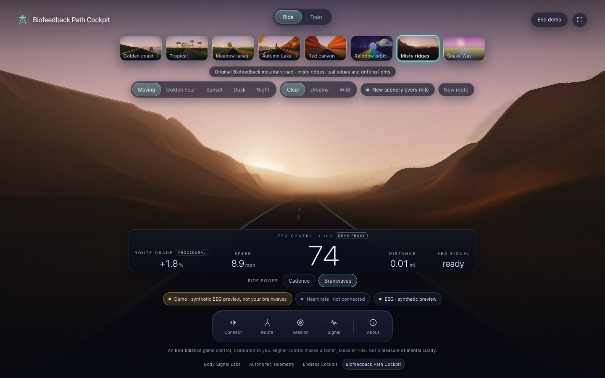

# Body Signal Labs

**[Open the home page](https://patrickiben.github.io/body-signal-labs/)** · [Autonomic Telemetry](https://patrickiben.github.io/autonomic-telemetry/) · [Endless Cockpit](https://patrickiben.github.io/body-signal-labs/endless-cockpit.html) · [Biofeedback Path Cockpit](https://patrickiben.github.io/body-signal-labs/biofeedback-path-cockpit.html) · [Field guide](https://patrickiben.github.io/body-signal-labs/field-guide.html)

Immersive scenes that follow signals from your body, in the browser. Each page reads a signal from you and says plainly what it measured and what it inferred. No page here is a medical device.


**Autonomic Telemetry** is a galaxy whose extent, brightness and warmth follow a personal, experimental estimate of arousal, inferred from heart rate and pulse variability, with EEG shown as context. Work keeps watch, and Rest adds paced breathing. A labeled demo runs in any browser, and live signals come through a small bridge on a Mac. It lives in [its own repository](https://github.com/patrickiben/autonomic-telemetry).


**Endless Cockpit** takes you through eight scenes shared with Biofeedback Path Cockpit: Golden coast, Tropical preserve, Meadow lanes, New England Autumn, Red canyon, Rainbow orbit, Misty pines and Snake Way. Ride beside the sea, through autumn woodland or misty mountain ridges, along a rainbow skyway, or over golden clouds on a winding serpent road. The routes have different terrain, objects, widths, bends and elevation profiles. Your cadence sets the speed, from a Bluetooth sensor or smart trainer, the pedal button, or a steady setting. Both cockpits use the same cadence acceleration, braking and grade response. Clear is the default look; Dreamy and Wild add visual feedback. New scenery every mile changes the landscape as you ride. These are procedural places, not GPS routes.



**Biofeedback Path Cockpit** combines the shared scenery with body-driven weather and fog controls. Watch uses the inferred index to change the sky; Ride uses cadence and can add heart-rate grade-load; Train turns paced heart-rate variation into a fog-clearing game. Its original Misty pines environment remains available. In Ride, optional **Brainwaves** drive uses Muse S EEG to set speed and smoothness without cadence or a heart sensor. It runs through the local Mac bridge, with personal calibration and visible signal quality; the EEG balance is an experimental game control, not a measurement of mental clarity. The inferred index is Autonomic Telemetry's own model.

## What the pages tell you

Each sensor says whether it is not connected, waiting for you to choose, refused, missing, connected with no reading, live, or disconnected. A demo and a replay carry their own labels, so synthetic readings can never pass for yours.

## Browsers

The cockpits connect heart and cadence sensors over Web Bluetooth, in Chrome or Edge on a computer. Safari and Firefox do not have it, and every demo still runs there. Muse S uses the optional Mac bridge instead of browser Bluetooth; see [EEG setup](docs/EEG_SETUP.md). [Inputs](docs/INPUTS.md) has the details, with sources.

## Open it locally

The cockpit pages are self-contained. Open `endless-cockpit.html` or `biofeedback-path-cockpit.html` directly, or serve the folder:

```sh
python3 -m http.server 8090
```

For Muse S Brainwaves drive, use the [optional bridge launcher](docs/EEG_SETUP.md), which serves the cockpit and EEG stream from the same private local address. The static page alone does not connect to Muse.

Edit `src/`, then run `python3 build.py`, which inlines everything into the pages. The suite bar links to Autonomic Telemetry by a relative path, so a clone of [autonomic-telemetry](https://github.com/patrickiben/autonomic-telemetry) beside this one makes the bar work on disk too.

## Read more

- [Field guide](field-guide.html): connecting each page, what each status means, and what is measured or inferred.
- [Inputs](docs/INPUTS.md): the Bluetooth profiles each cockpit reads, and browser support.
- [Methods](docs/METHODS.md): Endless Cockpit's road, feedback loop and flicker limiter.
- [Biofeedback Path Cockpit](docs/BIOFEEDBACK.md): its signals, modes and the inferred index.
- [Review](docs/REVIEW.md): repaired failure cases and recommended next improvements.
- [Validation](docs/VALIDATION.md): what was tested, how, and what still needs a real sensor.

## Credit

No outside code is included, apart from Autonomic Telemetry's own engine, which Biofeedback Path Cockpit carries under the same license. The feedback loop follows an idea from [Butterchurn](https://github.com/jberg/butterchurn) (MIT), and the Hume Band's commands follow [j2208-band-tools](https://github.com/brendangooden/j2208-band-tools) (MIT).

MIT license.
