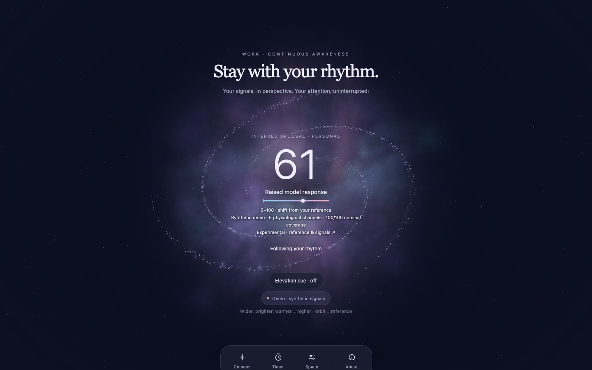
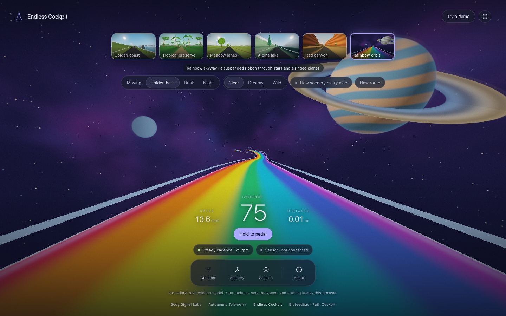
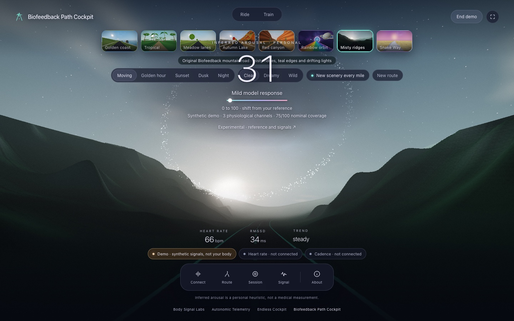

# Body Signal Labs

**[Open the home page](https://patrickiben.github.io/body-signal-labs/)** · [Autonomic Telemetry](https://patrickiben.github.io/autonomic-telemetry/) · [Endless Cockpit](https://patrickiben.github.io/body-signal-labs/endless-cockpit.html) · [Biofeedback Path Cockpit](https://patrickiben.github.io/body-signal-labs/biofeedback-path-cockpit.html) · [Field guide](https://patrickiben.github.io/body-signal-labs/field-guide.html)

Immersive scenes that follow signals from your body, in the browser. Each page reads a signal from you and says plainly what it measured and what it inferred. No page here is a medical device.



**Autonomic Telemetry** is a galaxy whose extent, brightness and warmth follow a personal, experimental estimate of arousal, inferred from heart, breath and brain signals. Work keeps watch, and Rest adds paced breathing. A labeled demo runs in any browser, and live signals come through a small bridge on a Mac. It lives in [its own repository](https://github.com/patrickiben/autonomic-telemetry).



**Endless Cockpit** takes you along six different cycling routes: a cliffside coast with open water and sea stacks, a tropical nature preserve with palms and colorful flowering plants, fenced country lanes past farmsteads, a turquoise alpine lake under snowy peaks, a winding sandstone canyon, and a rainbow skyway suspended among stars and a ringed planet. Each has its own terrain, roadside objects, path width, bends and elevation profile, with subtle wildflowers and occasional birds or small reptiles. Your cadence sets the speed, from a Bluetooth cadence sensor or smart trainer, the pedal button, or a steady setting. A Clear look is the default; Dreamy and Wild add the light trails and feedback. With New scenery every mile on, the landscape changes as you ride. These are procedural places, not GPS routes.



**Biofeedback Path Cockpit** is a road whose weather, grade and fog follow your body. Heart rate from a Bluetooth strap paints the weather, cadence sets the speed, and a paced-breathing game clears the fog. The inferred index is Autonomic Telemetry's own model. Everything about your state is inferred, and labeled as inferred.

## What the pages tell you

Each sensor says whether it is not connected, waiting for you to choose, refused, missing, connected with no reading, live, or disconnected. A demo and a replay carry their own labels, so synthetic readings can never pass for yours.

## Browsers

The cockpits connect sensors over Web Bluetooth, in Chrome or Edge on a computer. Safari and Firefox do not have it, and every demo still runs there. [Inputs](docs/INPUTS.md) has the details, with sources.

## Open it locally

The cockpit pages are self-contained. Open `endless-cockpit.html` or `biofeedback-path-cockpit.html` directly, or serve the folder:

```sh
python3 -m http.server 8090
```

Edit `src/`, then run `python3 build.py`, which inlines everything into the pages. The suite bar links to Autonomic Telemetry by a relative path, so a clone of [autonomic-telemetry](https://github.com/patrickiben/autonomic-telemetry) beside this one makes the bar work on disk too.

## Read more

- [Field guide](field-guide.html): connecting each page, what each status means, and what is measured or inferred.
- [Inputs](docs/INPUTS.md): the Bluetooth profiles each cockpit reads, and browser support.
- [Methods](docs/METHODS.md): Endless Cockpit's road, feedback loop and flicker limiter.
- [Biofeedback Path Cockpit](docs/BIOFEEDBACK.md): its signals, modes and the inferred index.
- [Validation](docs/VALIDATION.md): what was tested, how, and what still needs a real sensor.

## Credit

No outside code is included, apart from Autonomic Telemetry's own engine, which Biofeedback Path Cockpit carries under the same license. The feedback loop follows an idea from [Butterchurn](https://github.com/jberg/butterchurn) (MIT), and the Hume Band's commands follow [j2208-band-tools](https://github.com/brendangooden/j2208-band-tools) (MIT).

MIT license.
